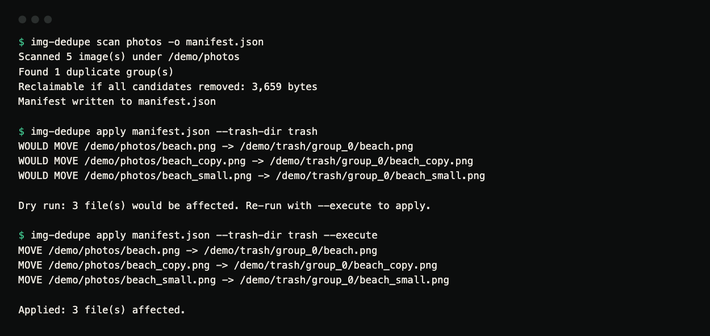

# img-dedupe

Find near-duplicate images by perceptual hash, cluster them, and produce a
review manifest before anything is deleted.

**Status:** version 0.1.0, not on PyPI. CI runs the tests on Linux, macOS and
Windows with Python 3.10 to 3.13, plus ruff, strict mypy and a scan/apply smoke
test on generated images. It has been tested on synthetic images, not on large
real photo libraries.

## Demo



*Terminal capture of a real run on five generated images: one picture saved as
`beach.png`, an identical `beach_copy.png`, a half-size `beach_small.png`, a
JPEG `beach_export.jpg`, and an unrelated `harbour.png`.*

```console
$ img-dedupe scan photos -o manifest.json
Scanned 5 image(s) under /demo/photos
Found 1 duplicate group(s)
Reclaimable if all candidates removed: 3,659 bytes
Manifest written to manifest.json

$ img-dedupe apply manifest.json --trash-dir trash
WOULD MOVE /demo/photos/beach.png -> /demo/trash/group_0/beach.png
WOULD MOVE /demo/photos/beach_copy.png -> /demo/trash/group_0/beach_copy.png
WOULD MOVE /demo/photos/beach_small.png -> /demo/trash/group_0/beach_small.png

Dry run: 3 file(s) would be affected. Re-run with --execute to apply.

$ img-dedupe apply manifest.json --trash-dir trash --execute
MOVE /demo/photos/beach.png -> /demo/trash/group_0/beach.png
MOVE /demo/photos/beach_copy.png -> /demo/trash/group_0/beach_copy.png
MOVE /demo/photos/beach_small.png -> /demo/trash/group_0/beach_small.png

Applied: 3 file(s) affected.
```

`harbour.png` was not grouped. Note which copy was kept: all three full-size
copies tie on resolution, so the next default strategy, `file_size`, picks the
largest file, and here that is the JPEG (3,718 bytes) rather than the lossless
PNG (1,005 bytes). This is exactly the kind of decision the review step exists
for. Change the member actions in the manifest, or pass a different
`--strategy-order`, before running `apply --execute`.

## What

img-dedupe scans a directory of images, computes perceptual hashes for each
one, groups near-duplicates together, works out which copy in each group is
the "best" one to keep (on evidence, not luck), and writes a JSON manifest
describing every group, every member, and the proposed action. A separate
`apply` command then executes a manifest that a human has reviewed. The
`scan` command never deletes or moves a file.

## Why

Photo libraries and product-image catalogues accumulate resizes,
re-encodes, crops, and watermarked variants of the same picture over time.
Byte-level deduplication (matching on file hash) misses all of these,
because the bytes differ even though the picture is "the same" to a human.
Perceptual hashing finds them, but a tool that deletes as soon as two images
fall under a similarity threshold will eventually delete the wrong one. img-dedupe treats
review as a first-class step: it never deletes during a scan, it explains
why it picked the copy it picked, and `apply` refuses to remove every member
of a group.

## How perceptual hashing works here

Four algorithms are implemented from scratch on top of numpy and Pillow, with
no OpenCV and no `imagehash` library:

- **aHash (average hash).** Shrink the image to an 8x8 greyscale
  thumbnail, take the mean brightness, and set one bit per pixel for
  "brighter than the mean". Cheap and fast, but sensitive to brightness/
  contrast changes.
- **dHash (difference hash).** Shrink to a 9x8 thumbnail and set one bit
  per pixel for "brighter than my right-hand neighbour". This encodes
  gradient direction rather than absolute brightness, so it's more robust
  to exposure changes than aHash.
- **pHash (perceptual hash).** The default. Shrink to a
  32x32 greyscale thumbnail, take its 2D Discrete Cosine Transform (DCT-II),
  keep the low-frequency 8x8 corner (excluding the DC term, which only
  encodes overall brightness), and threshold against the median. Because it
  operates on frequency content rather than raw pixel values, pHash is the
  most robust of the four to re-encoding, mild resizing, and small colour
  shifts. The DCT itself is implemented directly from its definition as an
  orthonormal `N x N` basis matrix (`C[k, x] = alpha(k) * cos(pi/N * (x +
  0.5) * k)`), applied as `C @ image @ C.T`. There is no FFT and no scipy,
  and it is small enough to check by hand (see `tests/test_dct.py`).
- **wHash (wavelet hash).** A simplified single-level Haar low-pass hash:
  repeatedly average non-overlapping 2x2 blocks of a thumbnail down to the
  target grid size, then threshold against the median.

Two hashes are compared with the **Hamming distance** (the number of
differing bits). Two hashes can only be compared if they come from the same
algorithm and the same grid size. Comparing an 8x8 pHash with a 4x4 aHash
raises an error rather than returning a meaningless number.

## Features

- Four from-scratch perceptual hash algorithms (aHash, dHash, pHash, wHash).
- Union-find clustering over the pairwise-under-threshold similarity graph,
  so a chain of similar images (A close to B, B close to C) ends up in one
  group even if A and C aren't directly close.
- Best-copy selection with a configurable strategy order. Each strategy
  prefers the higher value: `resolution` (more pixels), `file_size` (larger
  file), `compression` (more bytes per pixel, so less compressed), `oldest` or
  `newest` (file mtime). Members are compared pairwise and the first strategy
  that differs decides; if all tie, the lexicographically first path wins.
  The manifest's `keep.reason` records the values behind the last of those
  pairwise comparisons, not every one.
- Variant classification per pair: `exact_duplicate` (identical bytes),
  `re_encode` (same dimensions, different bytes), `resize` (same aspect
  ratio within 2%, different dimensions), `crop` (different aspect ratio), and
  `similar` when an image reports zero width or height. The group's `variant`
  is the most specific label among its members.
- A JSON review manifest listing every group, every member's metrics, and
  the proposed action. Nothing is deleted until `apply` is run against a
  manifest.
- `apply` refuses to remove every member of a group, and supports
  `--trash-dir` to move files instead of deleting them.
- Filters: `--min-size`, `--extensions`, `--recursive` (the default) /
  `--no-recursive`.
- Reports total reclaimable bytes.

## Architecture

```
src/img_dedupe/
  hashing.py    aHash, dHash, pHash (DCT-II from scratch), wHash, Hamming distance
  metadata.py   filesystem + image metadata, sha256, image discovery/filters
  cluster.py    union-find over a pairwise Hamming-distance graph
  classify.py   exact_duplicate / re_encode / resize / crop classification
  selection.py  configurable best-copy selection with recorded reasons
  scan.py       orchestrates discovery -> hashing -> clustering -> manifest
  manifest.py   manifest validation and the apply-time safety checks
  cli.py        `img-dedupe scan` / `img-dedupe apply`
```

## Installation

Requires Python 3.10+. Not published on PyPI; install from a clone:

```bash
git clone https://github.com/hellpuffyt/img-dedupe && cd img-dedupe
python -m venv .venv && . .venv/bin/activate
pip install -e .
```

The only runtime dependencies are `Pillow` and `numpy`.

## Usage

### Scan a directory

```bash
img-dedupe scan ./photos -o manifest.json
```

Useful options:

```bash
img-dedupe scan ./photos \
  --extensions jpg,jpeg,png \
  --min-size 2048 \
  --algorithm phash \
  --hash-size 8 \
  --threshold 10 \
  --strategy-order resolution,file_size,compression,oldest \
  -o manifest.json
```

| Option | Default | Meaning |
| --- | --- | --- |
| `-o`, `--output` | `manifest.json` | Where to write the manifest |
| `--recursive` / `--no-recursive` | recursive | Whether to descend into subdirectories |
| `--extensions` | `jpg,jpeg,png,bmp,gif,webp,tiff` | Comma-separated; the leading dot is optional and case is ignored |
| `--min-size` | `0` | Skip files smaller than this many bytes |
| `--algorithm` | `phash` | `ahash`, `dhash`, `phash` or `whash` |
| `--hash-size` | `8` | Hash grid side length, so the hash has `hash_size^2` bits |
| `--threshold` | `10` | Maximum Hamming distance for two images to count as near-duplicates. Lower is stricter |
| `--strategy-order` | `resolution,file_size,compression,oldest` | Best-copy strategies, from `resolution`, `file_size`, `compression`, `oldest`, `newest` |

`scan` exits `2` if the directory does not exist; `apply` exits `2` if the
manifest cannot be read or fails validation. Invalid arguments exit `2` with
a usage message, including an unknown or empty `--strategy-order`, which lists
the valid strategy names.

### Review the manifest

Open `manifest.json`. Each group lists every member with its metrics, which
one was chosen to `keep` and why, and each other member's proposed
`action` (`delete_candidate`). Edit `action` fields by hand if you disagree
with a proposal: set a member back to `"keep"` to preserve it.

### Apply a reviewed manifest

```bash
# Dry run (default): prints what would happen, touches nothing.
img-dedupe apply manifest.json

# Actually delete the delete_candidate files.
img-dedupe apply manifest.json --execute

# Move them to a trash directory instead of deleting.
img-dedupe apply manifest.json --trash-dir ./_trash --execute
```

`apply` validates the manifest and refuses to run if any group would have
every member removed. At least one member per group must be kept. With
`--trash-dir`, files are moved into a `group_<id>/` folder per group inside the
trash directory.

## Safety model

- `scan` **never** deletes or moves a file. It only reads images and writes
  a manifest.
- `apply` defaults to a dry run; nothing is touched without `--execute`.
- `apply` refuses to process a group where every member is marked
  `delete_candidate`. A manifest edited or generated that way is rejected
  before any file operation runs.
- `--trash-dir` moves files instead of deleting them, so removals can be
  undone by hand.
- A missing file referenced by the manifest is skipped, not treated as an
  error, because the manifest may be stale if files moved between `scan` and
  `apply`.
- Every removal is re-checked at run time and skipped (`SKIP (...)`) when no
  member of its group marked `keep` still exists on disk, when it is the same
  file as a kept member (e.g. through a symlink), or when its bytes no longer
  match the `sha256` the scan recorded.
- With `--trash-dir`, a name already taken in `trash/group_<id>/` gets a
  numeric suffix (`photo_1.png`); nothing in the trash is ever overwritten.

## Manifest format

This is the manifest from the demo above, with two of the four group members
shown and the hashes shortened:

```json
{
  "version": 1,
  "generated_at": "2026-10-26T07:22:08.184816+00:00",
  "root": "/demo/photos",
  "settings": {
    "recursive": true,
    "extensions": [".jpg", ".jpeg", ".png", ".bmp", ".gif", ".webp", ".tiff"],
    "min_size": 0,
    "algorithm": "phash",
    "hash_size": 8,
    "threshold": 10,
    "strategy_order": ["resolution", "file_size", "compression", "oldest"]
  },
  "summary": {
    "total_images": 5,
    "duplicate_groups": 1,
    "reclaimable_bytes": 3659
  },
  "groups": [
    {
      "group_id": 0,
      "variant": "re_encode",
      "reclaimable_bytes": 3659,
      "keep": {
        "path": "/demo/photos/beach_export.jpg",
        "reason": "beach_export.jpg kept over beach_small.png: higher resolution (40000.0 vs 10000.0 pixels)"
      },
      "members": [
        {
          "path": "/demo/photos/beach_export.jpg",
          "width": 200,
          "height": 200,
          "file_size": 3718,
          "sha256": "d7fe9dc6...",
          "mtime": 1792999327.9055333,
          "phash": "e88baaaaaa555555",
          "distance_to_kept": 0,
          "variant_vs_kept": "kept",
          "action": "keep"
        },
        {
          "path": "/demo/photos/beach_small.png",
          "width": 100,
          "height": 100,
          "file_size": 1649,
          "sha256": "f32c0c06...",
          "mtime": 1792999327.9015331,
          "phash": "e88baaaaaa555555",
          "distance_to_kept": 0,
          "variant_vs_kept": "resize",
          "action": "delete_candidate"
        }
      ]
    }
  ]
}
```

Each member carries the hash for the algorithm used, under that algorithm's
name (`phash` here). The `sha256` is what `apply` re-checks before removing a
file. Only groups with more than one member appear in `groups`; unique images are
counted in `summary.total_images` but not otherwise listed.

## Examples

Find and review duplicates in a photo library, keeping the newest copy of
each group instead of the default (highest resolution first):

```bash
img-dedupe scan ~/Pictures --recursive --strategy-order newest,resolution,file_size -o review.json
# ... inspect/edit review.json ...
img-dedupe apply review.json --trash-dir ~/Pictures/_dedupe_trash --execute
```

Only consider large JPEGs, with a tight similarity threshold:

```bash
img-dedupe scan ./catalogue --extensions jpg,jpeg --min-size 100000 --threshold 6 -o manifest.json
```

## Testing

```bash
pip install -e ".[dev]"
pytest          # 111 tests
ruff check .
mypy            # strict, over src/
```

The test suite generates every test image with Pillow; no binary fixtures are
committed. Coverage includes: DCT correctness against an
independently computed reference, hash stability under small quality
changes and instability across genuinely different content, union-find
chaining, best-copy selection for every strategy, variant classification,
and `apply`'s refusal to empty a group.

## Limitations

- The `compression` and `file_size` strategies are proxies. Bytes per pixel
  says nothing about a codec's quality setting, and, as the demo shows, a lossy
  JPEG can be larger than a lossless PNG of the same picture, so `file_size`
  may prefer it. Review the `keep` choices.
- Clustering is O(n^2) in the number of images (every pair is compared).
  This is the right trade-off for a batch, review-before-delete workflow,
  but it is not built for millions of images in one scan.
- Crop detection relies on aspect ratio and hash distance; it will not
  reliably detect crops with a preserved aspect ratio (those look like a
  resize) or extreme crops that fall outside the similarity threshold.
- Rotation and mirroring are not specifically modelled; rotated/flipped
  duplicates will generally not be clustered together by these hashes.

## Security

- img-dedupe only reads files under the directory you point it at (plus the
  manifest file you pass to `apply`) and only writes the manifest file and,
  during `apply`, the files it is told to delete or move.
- `apply` never deletes a path outside what the manifest lists, and never
  empties a group of every member.
- No network access is performed by any part of this tool.

Report vulnerabilities as described in [SECURITY.md](SECURITY.md).

## Verification

The DCT agrees with `scipy.fft.dctn(type=2, norm="ortho")` to floating-point
rounding (SciPy is used only for that check, it is not a dependency). The
recorded hash measurements in
[docs/PRODUCTION_READINESS.md](docs/PRODUCTION_READINESS.md) used 40 synthetic
images: every algorithm kept resized (0.5x, 2x) and JPEG-quality-60 variants
within Hamming distance 2 of the original, while unrelated images were at least
21 bits apart. Real photo libraries were not part of that test.

## Contributing

See [CONTRIBUTING.md](CONTRIBUTING.md).

## License

MIT. See [LICENSE](LICENSE).
